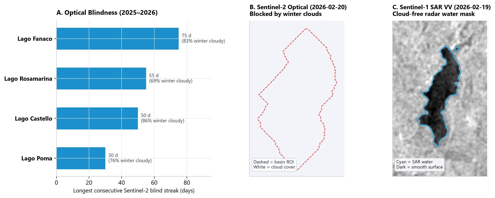
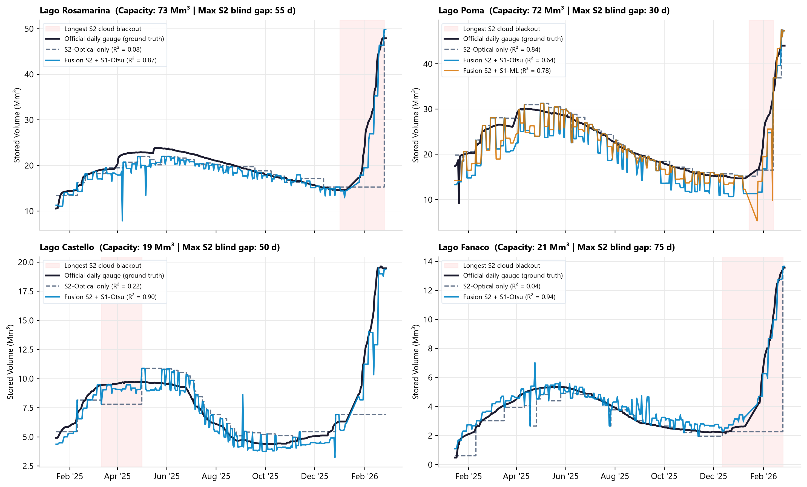

# Tracking Drought Reservoirs Through Clouds With Sentinel-1 Radar and Python

## I tested optical satellite imagery, classic radar thresholding, and self-supervised LightGBM against 385 days of real dam volumes in Sicily — and a 1979 algorithm beat gradient boosting on three of four lakes

One evening after a long day at work, my project lead called me from Ragusa, on the southern coast of Sicily, to go over a few loose ends. In passing, he mentioned standing near the sea in an unusually warm autumn wind. My mind immediately jumped to the severe water crisis that had gripped the island, and I wondered whether Sicily's reservoirs had finally started refilling.

I opened the Copernicus Browser to take a look for myself — and found days upon days of solid clouds. When I went looking for official dam reports, the most recent figures I could find were already lagging behind. That simple moment of frustration sparked the experiment below.

When you work around water utilities, you learn quickly that droughts do not end quietly. After months of slow, predictable drawdown under clear summer skies, a Mediterranean reservoir recovers in sudden winter bursts — two or three heavy storm weeks that can triple stored volume almost overnight.

That is also the exact moment optical satellites stop working.

Between December 2025 and February 2026, **Lago Fanaco** — a mountain reservoir in the province of Palermo that had dropped to just 2% of its authorized capacity — surged more than sixfold in volume. During that exact stretch, **Sentinel-2 was completely blocked by clouds for 75 consecutive days**.

If you monitor water resources with optical imagery alone, your dashboard flat-lines right when water managers need fresh numbers most.

In this walkthrough, I build a lightweight, CPU-only Python pipeline that pairs **Sentinel-2 optical imagery** with **Sentinel-1 radar** (which sees straight through clouds) and validates the results against **385 days of official daily dam measurements** across four Sicilian reservoirs. Along the way, the experiment turned up a humbling machine learning result: **a 1979 thresholding algorithm beat a self-supervised LightGBM model on three of the four lakes**, while gradient boosting clearly won on the fourth.

---

## Four Sicilian reservoirs and 1,880 real satellite passes

Too many satellite tutorials test water detection only against another satellite mask. Here, every estimate is checked against real water volumes measured at the dam wall.

I combined two free, open data sources:

- **Official dam volumes (ground truth)**: Published by Sicily's river basin authority (*Autorità di Bacino della Sicilia*) and neatly archived as CSV files by [Open Data Sicilia](https://github.com/opendatasicilia/emergenza-idrica-sicilia). We get monthly readings from 2022–2024 (used strictly for calibration) and **daily readings from January 2025 through February 2026** (held out completely for testing).
- **Satellite imagery (free, no API key)**: Optical **Sentinel-2** and radar **Sentinel-1** scenes pulled from the [Microsoft Planetary Computer](https://planetarycomputer.microsoft.com/) at 20-meter resolution.

Across four major reservoirs — **Lago Rosamarina**, **Lago Poma**, **Lago Castello**, and **Lago Fanaco** — the pipeline downloaded **700 optical scenes** and **1,180 radar scenes** spanning 2022 to early 2026:

| Reservoir | Capacity | 2025–2026 Low -> High | Winter Optical Passes Cloudy | Longest Optical Blackout |
| :--- | :---: | :---: | :---: | :---: |
| **Lago Rosamarina** | 73 million m³ | 15% -> 66% full | 69% | **55 days** (Jan–Feb 2026) |
| **Lago Poma** | 72 million m³ | 13% -> 61% full | 76% | **30 days** (Jan–Feb 2026) |
| **Lago Castello** | 19 million m³ | 22% -> 101% full | 86% | **50 days** (Mar–May 2025) |
| **Lago Fanaco** | 21 million m³ | 2% -> 66% full | 83% | **75 days** (Dec 2025–Feb 2026) |


*Figure 1: Left — longest consecutive Sentinel-2 cloud-blind streaks and winter cloudiness (2025–2026). Center and right — Lago Fanaco in late February 2026: Sentinel-2 sees solid white clouds on February 20, while Sentinel-1 radar the day before cuts straight through the storm to reveal the refilled lake. Image by author.*

---

## Reading satellite tiles in Python — without installing GDAL

If you have ever tried installing `rasterio` or GDAL on a locked-down Windows machine, you know how quickly native library conflicts can derail a weekend project. Because Planetary Computer stores Sentinel imagery as Cloud-Optimized GeoTIFFs, you can query the catalog and stream *only* the tiny tile covering a reservoir (~150 KB per band instead of a 100 MB scene) using standard Python HTTP range requests and `tifffile`:

```python
import pystac_client
import planetary_computer

catalog = pystac_client.Client.open(
    "https://planetarycomputer.microsoft.com/api/stac/v1",
    modifier=planetary_computer.sign_inplace,
)

# Lago Fanaco bounding box [min_lon, min_lat, max_lon, max_lat]
bbox = [13.525, 37.645, 13.585, 37.695]
time_range = "2022-01-01/2026-02-28"

optical_items = list(catalog.search(collections=["sentinel-2-l2a"], bbox=bbox, datetime=time_range).items())
radar_items   = list(catalog.search(collections=["sentinel-1-rtc"], bbox=bbox, datetime=time_range).items())
```

Why does radar spot water so well? Calm open water acts like a mirror: it bounces the satellite's radar beam away into space, so lakes show up **pitch black** in radar imagery (typically 8 to 11 decibels darker than surrounding soil and hillsides, which scatter the beam back toward the sensor).

To keep the test strictly honest, I defined each lake's search area using **only 2022–2024 clear optical images** — taking the main water body and adding a 400-meter buffer around the shoreline so future high-water expansion in 2026 still fits comfortably inside the box.

---

## Teaching LightGBM to see water in radar — with zero manual labels

Rather than hand-labeling thousands of pixels, I used a **self-supervised trick** on the 2022–2024 training years:

1. Take every cloud-free optical pass from 2022–2024 and pair it with the closest radar pass within four days (174 clean pairs across the four lakes).
2. Let the optical water index (green vs. shortwave infrared) automatically label pixels as **water** or **land** — skipping blurry shoreline pixels so the training signal stays crisp.
3. Feed a `LightGBM` classifier **11 simple radar features** per pixel: both radar polarizations (`VV` and `VH`), their difference, local neighborhood averages and texture (3×3 and 7×7 windows), and whether the satellite was flying north or south.

Notice what is *missing*: **no `(x, y)` coordinates**. If you give a tree model pixel coordinates, it simply memorizes the 2022–2024 shoreline and fails when the reservoir fills past its historical level in 2026.

```python
import numpy as np
from scipy.ndimage import uniform_filter, minimum_filter

def extract_radar_features(vv_db: np.ndarray, vh_db: np.ndarray, orbit: str, mask: np.ndarray) -> np.ndarray:
    vv = np.where(np.isfinite(vv_db), vv_db, np.nanmedian(vv_db))
    vh = np.where(np.isfinite(vh_db), vh_db, np.nanmedian(vh_db))

    vv_m3 = uniform_filter(vv, size=3, mode="nearest")
    vv_s3 = np.sqrt(np.maximum(uniform_filter((vv - vv_m3) ** 2, size=3, mode="nearest"), 0.0))
    vv_m7 = uniform_filter(vv, size=7, mode="nearest")
    vv_s7 = np.sqrt(np.maximum(uniform_filter((vv - vv_m7) ** 2, size=7, mode="nearest"), 0.0))
    vh_m3 = uniform_filter(vh, size=3, mode="nearest")
    vh_s3 = np.sqrt(np.maximum(uniform_filter((vh - vh_m3) ** 2, size=3, mode="nearest"), 0.0))

    orb_flag = 1.0 if orbit.lower().startswith("asc") else 0.0
    return np.stack([
        vv[mask], vh[mask], (vh - vv)[mask],
        vv_m3[mask], vv_s3[mask], vv_m7[mask], vv_s7[mask], minimum_filter(vv, 3)[mask],
        vh_m3[mask], vh_s3[mask],
        np.full(int(mask.sum()), orb_flag, dtype=np.float32),
    ], axis=1).astype(np.float32)
```

Training on half a million pixels took **2.6 seconds on a regular laptop CPU**. I also ran a **leave-one-lake-out test** — training on three reservoirs and predicting on the fourth unseen lake — to make sure the model genuinely understood radar physics rather than memorizing a specific valley.

### First trap I fell into: 50/50 class balancing

In my first draft, I sampled an equal 50% water / 50% land training set. That immediately inflated every area estimate. Inside each reservoir's buffered search box, water actually covers only **20% to 41%** of the pixels. Forcing a 50/50 training split pushes predicted probabilities upward, making a standard 0.50 cutoff classify damp mud and shorelines as water.

Switching back to **natural random sampling** inside the basin fixed the bias right away. Whenever your end goal is a physical count or surface area rather than a ranking score, keep the natural class balance.

---

## Turning lake area into cubic meters (respecting basic physics)

Water managers do not care about square kilometers; they care about **million cubic meters** of drinking and irrigation water. To translate surface area into stored volume, hydrologists fit a simple **power-law curve** to historical records:

$$V = c \cdot A^\gamma$$

### Second trap: leaving the intercept free

In an early version, I let the curve include a free constant term. On Lago Castello, where 2022–2024 training images were mostly mid-to-high water, the optimizer picked a positive intercept of roughly +7 million m³ — implying that a bone-dry lake with zero water surface still held 7 million cubic meters. When Castello shrank to 4.4 million m³ in autumn 2025, that curve simply could not go low enough.

Anchoring the curve at zero (**zero area = zero water**) solved the extrapolation completely:

```python
from scipy.optimize import curve_fit

def fit_area_to_volume(areas: np.ndarray, volumes: np.ndarray):
    valid = np.isfinite(areas) & np.isfinite(volumes) & (areas > 0.02) & (volumes > 0.05)
    popt, _ = curve_fit(
        lambda area, c, gamma: c * np.power(np.maximum(area, 1e-4), gamma),
        areas[valid],
        volumes[valid],
        p0=[10.0, 1.5],
        bounds=([0.1, 0.5], [200.0, 3.5]),
    )
    c, gamma = popt
    return lambda area: c * np.power(np.maximum(np.asarray(area, float), 1e-4), gamma)
```

Every curve was fit **strictly on 2022–2024 monthly bulletins** and frozen before touching a single day of 2025–2026.

---

## What actually happened on 385 real days (2025–2026)

To mimic a real monitoring dashboard, I simulated day-by-day tracking from **January 1, 2025 to February 27, 2026**. On each day, every method reports its most recent valid satellite reading — no peeking into the future — and is scored against that day's official dam measurement.

Here is the overall scoreboard averaged across all four reservoirs:

| Method | Daily Accuracy ($R^2$) | Typical Error (% of Capacity) | Days With Fresh Data ($\le 7$d) | Longest Blind Gap |
| :--- | :---: | :---: | :---: | :---: |
| **Fusion (Optical + Radar Otsu)** | **0.84** | **4.1%** | **100%** | **6 days** |
| **Fusion (Optical + Radar LightGBM)** | 0.78 | 5.2% | **100%** | **6 days** |
| **Radar Only (Classic Otsu)** | 0.75 | 4.7% | 99.6% | 11 days |
| **Radar Only (LightGBM)** | 0.67 | 6.1% | 99.6% | 11 days |
| **Radar Only (LightGBM, Unseen Lake)** | 0.62 | 6.3% | 99.6% | 11 days |
| **Optical Only (Sentinel-2)** | 0.30 | 9.3% | 57% | **119 days** |

And here is what that looks like over time on all four reservoirs:


*Figure 2: Daily volume tracking (Jan 2025 – Feb 2026) against official dam measurements (black). Shaded pink bands mark each lake's longest optical cloud blackout. While optical-only tracking (dashed gray) freezes during winter storms, optical + radar fusion (blue/orange) climbs right alongside the real gauge. Image by author.*

Look at the right edge of **Rosamarina**, **Castello**, and **Fanaco** in Figure 2. On sunny days alone, Sentinel-2 is remarkably accurate ($R^2 = 0.94 - 0.95$). Yet in daily operation it collapses to **$R^2 = 0.08$ on Rosamarina and $0.04$ on Fanaco** because the optical sensor goes blind at the exact moment winter storms refill the lakes.

Fusing optical and radar observations cuts normalized error more than in half (**4.1% vs. 9.3% of capacity**), guarantees a fresh reading at least every **6 days**, and tracks **Lago Fanaco at $R^2 = 0.94$** (average error just **0.43 million m³**).

### Third trap: smoothing filters lag behind real storms

At first, I added an exponential moving average to smooth out noisy radar passes. It made the summer curve look neat — and wrecked the winter storm surge, dragging Rosamarina's $R^2$ from `0.87` down to `0.64` because the filter reacted weeks too slowly to rapid inflows. Switching to **zero-lag fusion** — simply updating the estimate immediately whenever a clear optical or radar pass arrives, after calibrating both sensors into million m³ — fixed the lag immediately.

---

## The plot twist: why a 1979 threshold beat LightGBM on three lakes

When I compared pixel masks on 167 clear 2025–2026 test days, classic Otsu thresholding and LightGBM looked nearly tied (median overlap around 90% for both). Yet once converted to daily water volumes, a sharp split appeared across the four reservoirs:


*Figure 3: Per-reservoir breakdown of daily accuracy (left) and error as % of capacity (right). Classic Otsu thresholding wins on the three narrow valley reservoirs (Rosamarina, Castello, Fanaco), while LightGBM clearly beats Otsu on wide, windy Lago Poma. Image by author.*

Why did a 47-year-old thresholding algorithm beat gradient boosting on **Rosamarina, Castello, and Fanaco** — yet lose badly on **Lago Poma**?

It comes down to **radar physics and lake shape**:

1. **Adapting to each day's weather**: Wet soil, rain-soaked banks, and satellite viewing angles shift radar brightness slightly from pass to pass. **Otsu recalculates a fresh threshold on every single image**, absorbing those daily shifts automatically. A global LightGBM model applies fixed brightness cutoffs across all days, which introduces slight shoreline drift on unusually wet or dry passes.
2. **Wind on open water (Lago Poma)**: Rosamarina, Castello, and Fanaco sit in sheltered mountain valleys where water stays glassy smooth — a textbook dark-vs-bright split where Otsu shines. **Lago Poma** is a wide, exposed basin. On windy days, surface ripples scatter the main radar signal back toward the satellite, breaking Otsu's simple threshold (`R² = 0.34`). Because LightGBM also looks at **local texture** and **cross-polarized radar (`VH`)**, it rides through wind ripples much better — nearly cutting Poma's radar error in half and pushing fused accuracy to **$R^2 = 0.78$**.


*Figure 4: Left — the zero-anchored curve $V = 13.1 \cdot A^{1.46}$ fit on 2022–2024 monthly bulletins (gray) predicts unseen 2025–2026 daily volumes (orange) cleanly across a 6x refill. Right — the radar features LightGBM relied on most, led by local texture and cross-polarization. Image by author.*

---

## Five lessons worth keeping for your own geospatial projects

Even if you never monitor a single dam, five practical takeaways from this experiment carry straight over to floods, wetlands, agriculture, or urban mapping:

1. **Measure operational freshness, not just sunny-day accuracy.** A model with `0.95` accuracy on clear skies can still score `0.04` in production if clouds blind it whenever the target actually moves.
2. **Always benchmark ML against a simple, per-scene classical baseline.** On clean physical contrasts, a 1979 adaptive threshold is hard to beat — and seeing *where* it breaks (windy open water on Lago Poma) shows you exactly where ML earns its keep.
3. **Avoid 50/50 class balancing when predicting physical areas or counts.** Artificial balancing warps probabilities and biases totals unless you recalibrate afterward.
4. **Bake basic physics into empirical curves.** Enforcing *zero area = zero volume* prevented an embarrassing drought extrapolation failure.
5. **Be cautious with temporal smoothers on event-driven data.** A filter tuned to calm summer noise will lag weeks behind a sudden winter storm.

All code — including the zero-GDAL Python COG reader, satellite downloaders, LightGBM pipeline, and figure scripts — is open-source on GitHub at [github.com/parisid/drought-reserv-through-clouds-experiment](https://github.com/parisid/drought-reserv-through-clouds-experiment) and runs on a standard CPU.

---

*Data sources: Official Sicilian reservoir volumes from Autorità di Bacino del Distretto Idrografico della Sicilia via [Open Data Sicilia](https://github.com/opendatasicilia/emergenza-idrica-sicilia); Copernicus Sentinel-1 and Sentinel-2 imagery via [Microsoft Planetary Computer](https://planetarycomputer.microsoft.com/) (2022–2026).*
