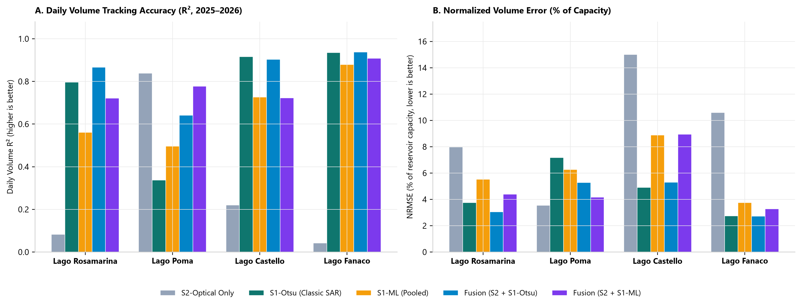
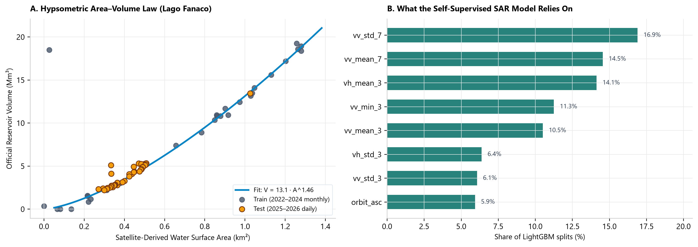

# Tracking Drought Reservoirs Through Clouds With Sentinel-1 SAR and Python

## I tested optical satellite imagery, classic radar thresholding, and self-supervised LightGBM against 385 days of real dam volumes in Sicily — and a 1979 algorithm beat gradient boosting on three of four lakes

One evening after a long day at work, my project lead called me from Ragusa, on the southern coast of Sicily, to go over a few loose ends. In passing, he mentioned standing near the sea in an unusually warm autumn wind. My mind immediately jumped to the severe water crisis that had gripped the island, and I wondered whether Sicily's reservoirs had finally started refilling.

I opened the Copernicus Browser to take a look for myself — and found days upon days of solid clouds. When I went looking for official dam reports, the most recent figures I could find were already lagging behind. That simple moment of frustration sparked the experiment below.

When you work around water utilities, you learn quickly that droughts do not end quietly. After months of slow, predictable drawdown under clear summer skies, a Mediterranean reservoir recovers in sudden winter bursts — two or three heavy storm weeks that can triple stored volume almost overnight. And that is the exact moment optical satellites stop working.

Over the winter of 2025–2026, Sicily began recovering from one of the worst water crises in its recent history. Between December 2025 and February 2026, **Lago Fanaco** — a mountain reservoir in the province of Palermo that had dropped to just 2.4% of its authorized capacity — surged more than sixfold in volume. During that exact window, **Sentinel-2 was completely blocked by clouds for 75 consecutive days**.

If you monitor reservoirs with optical imagery alone, your dashboard flat-lines right when water managers need fresh numbers most.

In this walkthrough, I build a fully reproducible, CPU-only Python pipeline — with **zero GDAL installation** — that combines **Sentinel-2 optical imagery** with **Sentinel-1 Synthetic Aperture Radar (SAR)**, which sees straight through clouds. I validate five approaches strictly out-of-time against **385 days of official daily dam gauge readings (January 2025 – February 2026)** across four Sicilian reservoirs: **Lago Rosamarina**, **Lago Poma**, **Lago Castello**, and **Lago Fanaco**.

Along the way, the experiment produced an honest, humbling machine learning result: **a 1979 unsupervised thresholding algorithm (Otsu) outperformed a self-supervised LightGBM model on three of the four reservoirs**, while LightGBM clearly won on the fourth. Understanding *why* — and fixing three subtle ML traps that initially broke the pipeline — turned out to be the most useful part of the entire project.

---

## The dataset: 1,880 real satellite scenes and official daily dam gauges

Too many geospatial tutorials evaluate water detection only against another satellite mask, or rely on smoothed reanalysis products. Here, every number is validated against physical water volumes measured at the dam wall.

I combined two open data sources:

1. **Official reservoir volumes (ground truth)**: Published by the *Autorità di Bacino del Distretto Idrografico della Sicilia* and archived in structured CSV format by the civic open-data project [Open Data Sicilia](https://github.com/opendatasicilia/emergenza-idrica-sicilia). The archive gives us **monthly official volumes from 2007 to 2025** (used strictly for 2022–2024 calibration) and **385 daily official readings per reservoir from January 2025 to February 27, 2026** (held out strictly for out-of-time testing).
2. **Satellite imagery (free, no API key)**: **Sentinel-2 L2A** (optical surface reflectance + `SCL` scene classification) and **Sentinel-1 RTC** (Radiometrically Terrain-Corrected C-band radar, `VV` and `VH` polarizations), queried from the [Microsoft Planetary Computer STAC API](https://planetarycomputer.microsoft.com/) at 20-meter UTM Zone 33N resolution.

Across the four reservoirs, the pipeline cached **700 Sentinel-2 scenes** and **1,180 Sentinel-1 RTC scenes** spanning January 2022 through February 2026:

| Reservoir | Authorized Capacity | 2025–2026 Daily Min -> Max | Winter S2 Cloudy Passes (Nov–Mar) | Longest S2 Cloud Blackout |
| :--- | :---: | :---: | :---: | :---: |
| **Lago Rosamarina** (`dig-22`) | 73.0 Mm³ | 10.6 -> 47.9 Mm³ (15% -> 66%) | 69.2% | **55 days** (Jan 1 – Feb 25, 2026) |
| **Lago Poma** (`dig-18`) | 72.3 Mm³ | 9.2 -> 44.0 Mm³ (13% -> 61%) | 75.9% | **30 days** (Jan 14 – Feb 13, 2026) |
| **Lago Castello** (`dig-03`) | 19.5 Mm³ | 4.4 -> 19.6 Mm³ (22% -> 101%) | 85.7% | **50 days** (Mar 12 – May 1, 2025) |
| **Lago Fanaco** (`dig-07`) | 20.7 Mm³ | 0.5 -> 13.6 Mm³ (2% -> 66%) | 83.3% | **75 days** (Dec 12 – Feb 25, 2026) |


*Figure 1: Left — longest consecutive Sentinel-2 cloud-blind streaks and winter cloud cover rates (2025–2026). Center and right — Lago Fanaco in late February 2026: Sentinel-2 sees solid white clouds on February 20, while Sentinel-1 SAR VV backscatter the day before cuts straight through the storm to reveal the refilled lake. Image by author.*

---

## Step 1: Querying Cloud-Optimized GeoTIFFs without GDAL headaches

If you have ever tried installing `rasterio` and GDAL on a locked-down Windows workstation, you know how quickly native DLL conflicts can derail a project. Because Planetary Computer serves both Sentinel-2 and Sentinel-1 RTC as **Cloud-Optimized GeoTIFFs (COGs)**, you do not actually need GDAL to crop a reservoir window.

Using `pystac-client`, `planetary-computer`, and HTTP `Range` requests via `tifffile`, we can download *only* the internal TIFF tiles that intersect a reservoir's bounding box — roughly 150 KB per band instead of a 100 MB granule:

```python
import pystac_client
import planetary_computer

catalog = pystac_client.Client.open(
    "https://planetarycomputer.microsoft.com/api/stac/v1",
    modifier=planetary_computer.sign_inplace,
)

# Lago Fanaco bounding box [min_lon, min_lat, max_lon, max_lat]
bbox = [13.525, 37.645, 13.585, 37.695]
time_range = "2022-01-01/2026-02-28"

s2_items = list(catalog.search(collections=["sentinel-2-l2a"], bbox=bbox, datetime=time_range).items())
s1_items = list(catalog.search(collections=["sentinel-1-rtc"], bbox=bbox, datetime=time_range).items())
```

Each Sentinel-1 RTC scene returns linear radar backscatter (`vv` and `vh`), which we convert to decibels ($\sigma^0_{\text{dB}} = 10 \log_{10}(\sigma^0)$). Calm open water acts like a specular mirror that bounces the radar pulse away from the satellite, producing a stark **8 to 11 dB drop** compared to surrounding soil and vegetation (for example, median `VV` on Lago Fanaco is `-20.9 dB` over water vs. `-9.6 dB` over land).

To avoid any future data leakage, I defined each reservoir's search envelope **strictly from 2022–2024 clear Sentinel-2 passes**: taking the union of optical water pixels (`MNDWI > 0.05` and `SCL == 6`), retaining the largest connected component (the reservoir itself, dropping nearby farm ponds), and dilating outward by 400 meters so future 2025–2026 high-water expansion fits comfortably inside the mask.

---

## Step 2: Training a radar water detector with zero manual labels

To build a machine learning SAR water detector without hand-labeling a single pixel, I used **cross-modal self-supervision** strictly on the **2022–2024 training window**:

1. Take every cloud-free Sentinel-2 pass (`basin_cloud_frac < 2%`) and pair it with the closest Sentinel-1 pass within $\pm 4$ days (yielding **174 clear S1–S2 pairs** across the four reservoirs).
2. Generate automatic binary labels from optical `MNDWI = (B03 - B11) / (B03 + B11)`: pixels with `MNDWI > 0` and `SCL == 6` are labeled `water = 1`; cloud-free pixels with `MNDWI < -0.10` are labeled `land = 0`. Ambiguous shoreline pixels between `-0.10` and `0` are excluded from training.
3. Compute **11 physics-informed SAR features** per pixel — deliberately excluding `(x, y)` coordinates so the tree model cannot memorize the 2022–2024 shoreline and fail to extrapolate when water rises in 2026:

```python
import numpy as np
from scipy.ndimage import uniform_filter, minimum_filter

def extract_sar_features(vv_db: np.ndarray, vh_db: np.ndarray, orbit_state: str, mask: np.ndarray) -> np.ndarray:
    vv = np.where(np.isfinite(vv_db), vv_db, np.nanmedian(vv_db))
    vh = np.where(np.isfinite(vh_db), vh_db, np.nanmedian(vh_db))

    vv_m3 = uniform_filter(vv, size=3, mode="nearest")
    vv_s3 = np.sqrt(np.maximum(uniform_filter((vv - vv_m3) ** 2, size=3, mode="nearest"), 0.0))
    vv_m7 = uniform_filter(vv, size=7, mode="nearest")
    vv_s7 = np.sqrt(np.maximum(uniform_filter((vv - vv_m7) ** 2, size=7, mode="nearest"), 0.0))
    vv_min3 = minimum_filter(vv, size=3, mode="nearest")

    vh_m3 = uniform_filter(vh, size=3, mode="nearest")
    vh_s3 = np.sqrt(np.maximum(uniform_filter((vh - vh_m3) ** 2, size=3, mode="nearest"), 0.0))
    orb_asc = 1.0 if orbit_state.lower().startswith("asc") else 0.0

    return np.stack([
        vv[mask], vh[mask], (vh - vv)[mask],
        vv_m3[mask], vv_s3[mask], vv_m7[mask], vv_s7[mask], vv_min3[mask],
        vh_m3[mask], vh_s3[mask],
        np.full(int(mask.sum()), orb_asc, dtype=np.float32),
    ], axis=1).astype(np.float32)
```

Training a 250-tree `LightGBM` classifier on **522,000 pixels** from 2022–2024 took **2.6 seconds on a standard 6-core CPU**. I also trained four **Leave-One-Reservoir-Out (LORO)** models — each trained on three reservoirs and tested on the fourth unseen lake — to verify genuine geographic generalization.

### Pitfall #1: Why 50/50 class balancing quietly ruined area estimates

In my first prototype, I sampled 1,500 water pixels and 1,500 land pixels per training pair (a classic 50/50 balanced dataset). That turned out to be a costly mistake. Inside each reservoir's 400-meter basin envelope, water naturally occupies only **20% to 41%** of pixels. Artificially forcing a 50/50 training prior shifts the model's posterior probabilities upward, causing a standard `p >= 0.50` threshold to systematically over-classify wet mud and shoreline pixels as water.

Simply switching to **natural-prior random sampling** inside the basin envelope immediately improved held-out 2025–2026 water-mask IoU and cut volume RMSE across all four reservoirs. Whenever your downstream target is a *count or physical area* rather than ranking, preserve the natural class prior (or recalibrate probabilities before thresholding).

---

## Step 3: Turning water area into cubic meters (without breaking physics)

A water utility does not manage square kilometers; it manages **million cubic meters (Mm³)**. To convert satellite-derived surface area $A$ into stored volume $V$, hydrologists use a **hypsometric power law**:

$$V(A) = c \cdot A^\gamma$$

### Pitfall #2: The danger of a free intercept

In an earlier run, I allowed a free intercept $V(A) = c_0 + c_1 A^\gamma$. On Lago Castello, where 2022–2024 optical calibration points were mostly mid-to-high water, `scipy.optimize.curve_fit` settled on a large positive intercept ($c_0 \approx +7\text{ Mm}^3$). When Castello dropped to 4.4 Mm³ in autumn 2025, that free intercept made it mathematically impossible for the model to predict below 7 Mm³ — destroying $R^2$ even on cloud-free days.

Enforcing the obvious physical boundary condition $V(0) = 0$ (zero surface area must hold zero water) fixed the extrapolation completely:

```python
from scipy.optimize import curve_fit

def fit_hypsometric(areas: np.ndarray, volumes: np.ndarray):
    valid = np.isfinite(areas) & np.isfinite(volumes) & (areas > 0.02) & (volumes > 0.05)
    popt, _ = curve_fit(
        lambda a, c, gamma: c * np.power(np.maximum(a, 1e-4), gamma),
        areas[valid],
        volumes[valid],
        p0=[10.0, 1.5],
        bounds=([0.1, 0.5], [200.0, 3.5]),
    )
    c, gamma = popt
    return lambda a: c * np.power(np.maximum(np.asarray(a, float), 1e-4), gamma)
```

Every hypsometric curve was fit **strictly on 2022–2024 monthly official volumes** ($\le 36$ points per reservoir) and frozen before touching a single day of 2025–2026.

---

## Results: Optical blindness vs. SAR vs. Multi-Modal Fusion (2025–2026)

To evaluate what an operational monitoring system actually delivers day by day, I simulated real-time tracking from **January 1, 2025 to February 27, 2026** (383–384 daily ground-truth gauge readings per reservoir). On every calendar day, each method holds its most recent valid satellite estimate (strictly causal forward-fill — zero future lookahead).

Here is the aggregate scoreboard across all four reservoirs:

| Method | Mean Daily $R^2$ | Mean MAE (Mm³) | Mean RMSE (Mm³) | Mean NRMSE (% Capacity) | Days with Obs. $\le 7$d Old | Worst Stale Gap |
| :--- | :---: | :---: | :---: | :---: | :---: | :---: |
| **Fusion (`S2 + S1-Otsu`)** | **0.837** | **1.44** | **1.91** | **4.08%** | **100.0%** | **6 days** |
| **Fusion (`S2 + S1-ML`)** | 0.783 | 1.49 | 2.16 | 5.20% | **100.0%** | **6 days** |
| **S1-Otsu (Classic SAR)** | 0.746 | 1.91 | 2.37 | 4.65% | 99.6% | 11 days |
| **S1-ML (Pooled LightGBM)** | 0.666 | 1.87 | 2.77 | 6.11% | 99.6% | 11 days |
| **S1-ML (LORO Unseen Lake)** | 0.616 | 1.93 | 2.97 | 6.30% | 99.6% | 11 days |
| **S2-Optical Only (`MNDWI`)** | 0.296 | 1.55 | 3.38 | 9.28% | 57.0% | **119 days** |

And here is what those numbers look like on the ground across all four reservoirs:


*Figure 2: Out-of-time daily volume tracking (Jan 2025 – Feb 2026) against official dam gauge readings (black). Shaded pink bands mark each reservoir's longest Sentinel-2 cloud blackout. While optical-only tracking (dashed gray) flat-lines during winter storms, multi-modal fusion (blue/orange) tracks the rapid refill continuously. Image by author.*

Look closely at the right edge of **Lago Rosamarina**, **Lago Castello**, and **Lago Fanaco** in Figure 2. On clear days alone, Sentinel-2 is extraordinarily accurate ($R^2 = 0.943$ on Rosamarina, $0.953$ on Poma). Yet operationally, **Sentinel-2 alone collapses to $R^2 = 0.08$ on Rosamarina and $R^2 = 0.04$ on Fanaco** because the optical sensor goes completely blind right as winter storms triple the reservoirs' volume.

Multi-modal fusion (`S2 + S1-Otsu`) cuts normalized error in half (**4.08% vs. 9.28% of capacity**), guarantees a fresh observation within **6 days on 100% of days**, and reaches **$R^2 = 0.937$ on Lago Fanaco** (MAE `0.43 Mm³`, `2.72%` of capacity) and **$R^2 = 0.903$ on Lago Castello**.

### Pitfall #3: Why aggressive smoothing hurts during storm refills

In my first fusion prototype, I applied a causal exponentially weighted moving average (EWMA, $\alpha_{\text{SAR}} = 0.45$) with a 35% jump guard to suppress noisy radar passes. During slow summer drawdowns, it looked great. During the January–February 2026 storm surges, that smoother lagged weeks behind the rising water, knocking Rosamarina's fusion $R^2$ down from `0.87` to `0.64`. Replacing EWMA with **zero-lag calibrated volume fusion** — updating immediately on every clear S2 or S1 pass in calibrated Mm³ space — recovered the full storm response immediately.

---

## The plot twist: why 1979 Otsu beat LightGBM on 3 of 4 lakes

Before looking at volumes, I evaluated pixel-level water segmentation on **167 held-out 2025–2026 clear S1–S2 pairs** ($\pm 2$ days). The three SAR detectors were remarkably close:

- **S1-Otsu (3×3 smoothed `VV` + Otsu threshold)**: mean IoU **0.838**, median IoU **0.901**, F1 **0.904**
- **S1-ML (Pooled LightGBM)**: mean IoU **0.829**, median IoU **0.900**, F1 **0.898**
- **S1-ML (LORO Unseen Reservoir)**: mean IoU **0.821**, median IoU **0.890**, F1 **0.893**

Yet when converted to daily volumes, a striking geographic split emerged:


*Figure 3: Per-reservoir breakdown of daily volume R² (left) and NRMSE as % of capacity (right). Classic per-scene Otsu thresholding dominates the three narrow valley reservoirs (Rosamarina, Castello, Fanaco), while LightGBM clearly outperforms Otsu on wide, windy Lago Poma. Image by author.*

**Why did a 47-year-old thresholding algorithm beat gradient boosting on Rosamarina, Castello, and Fanaco — yet lose badly on Lago Poma?**

The answer comes down to **radar physics and basin geometry**:

1. **Per-scene adaptation vs. global dB thresholds**: Soil moisture, rain-soaked banks, and orbital incidence angles shift the entire SAR backscatter distribution by 1–3 dB from one pass to the next. **Otsu's method computes a fresh optimal threshold on every single image**, automatically absorbing scene-wide radiometric shifts. A global LightGBM trained on absolute `VV`/`VH` decibels applies fixed split thresholds, which slightly over- or under-estimates shoreline pixels on unusually wet or dry days.
2. **Wind roughening on open water (Lago Poma)**: Rosamarina, Castello, and Fanaco sit inside narrow, sheltered mountain valleys where water stays glassy smooth in radar imagery — a textbook bimodal histogram where Otsu thrives. **Lago Poma** is a wide, exposed, 2.4 km² basin. On windy days, capillary waves roughen the water surface and raise `VV` backscatter toward land values, breaking Otsu's bimodal assumption (`R² = 0.337`, MAE `4.77 Mm³`). Because LightGBM relies heavily on multi-scale spatial texture (`vv_std_7`: 16.9%, `vv_mean_7`: 14.5%) and cross-polarization (`vh_mean_3`: 14.1%), it survives wind roughening far better — cutting Poma's SAR MAE nearly in half (**2.49 Mm³** in LORO unseen-lake mode vs. **4.77 Mm³** for Otsu!) and pushing `Fusion (S2 + S1-ML)` to **$R^2 = 0.778$** (`4.16%` NRMSE).


*Figure 4: Left — the zero-intercept hypsometric curve $V = 13.1 \cdot A^{1.46}$ fit strictly on 2022–2024 monthly volumes (gray) predicts unseen 2025–2026 daily volumes (orange) with high fidelity across a 6× refill. Right — LightGBM's top split features highlight why local texture (`vv_std_7`) and cross-polarization (`vh_mean_3`) help on windy lakes. Image by author.*

---

## Five takeaways for your own geospatial ML pipelines

Whether you are tracking reservoirs, wetlands, floods, or coastal erosion, five practical lessons from this benchmark transfer directly:

1. **Measure operational freshness, not just clear-sky accuracy.** A model with `0.95` $R^2$ on sunny days can still deliver `0.04` $R^2$ in production if clouds blind it during the exact weeks the target variable moves.
2. **Always benchmark against a strong, scene-adaptive classical baseline.** On bimodal physical signals like sheltered-lake SAR backscatter, per-scene Otsu thresholding is hard to beat — and diagnosing where it *fails* (windy open water on Lago Poma) tells you exactly where ML adds real value.
3. **Skip artificial 50/50 balancing when predicting physical areas or counts.** Balanced sampling distorts Bayes posteriors and biases area totals unless you explicitly recalibrate.
4. **Build physical boundary conditions into empirical fits.** Enforcing $V(0) = 0$ in the hypsometric power law prevented catastrophic drought extrapolation errors on Lago Castello.
5. **Be careful with temporal smoothers on event-driven systems.** A filter tuned to calm summer noise will lag badly behind rapid winter storm refills; zero-lag sensor fusion in calibrated physical units is often safer.

All code — including the zero-GDAL pure-Python COG reader, STAC download scripts, LightGBM training, and figure generators — is open-source on GitHub at [github.com/parisid/drought-reserv-through-clouds-experiment](https://github.com/parisid/drought-reserv-through-clouds-experiment) and runs in minutes on a standard CPU.

---

*Data sources: Official Sicilian reservoir volumes from Autorità di Bacino del Distretto Idrografico della Sicilia via [Open Data Sicilia](https://github.com/opendatasicilia/emergenza-idrica-sicilia); Sentinel-1 RTC and Sentinel-2 L2A imagery via [Microsoft Planetary Computer](https://planetarycomputer.microsoft.com/) (Copernicus Sentinel data, 2022–2026).*
